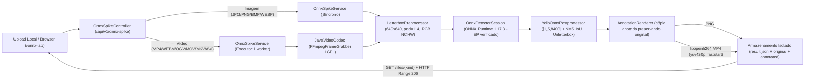

# Relatório Técnico do Spike da Fase 4 — Java 21 + ONNX Runtime + Decodificação de Vídeo e Visualizador Local

**Data:** 2026-11-20  
**Modelo de Referência (somente leitura):** `artifacts/runs/detect/exp04c_yolo26n_opentop_freeze10/weights/best.pt` (`YOLO26n`, `nc = 1`, `0: open_top_freight_wagon`, `imgsz = 640`)  
**Decisão de Portão Associada:** [ADR-0002: Portão P2 — Decisão pelo Runtime Embutido Java 21 + ONNX Runtime + JavaCV/FFmpeg](../adr/ADR-0002-gate-p2-java-onnx-runtime-decision.md)

---

## 1. Escopo, Preservação e Aviso Metodológico

- **Preservação integral das Fases 3 e 3.1:** nenhum peso, log, tabela, split ou arquivo de avaliação das Fases 3 e 3.1 (`exp01*..exp04c*`, `phase3_video_tracking_eval.json`, `phase3_1_open_top_mot_eval.json`, `data/processed/open-top-yolo-v1/`) foi modificado, movido ou sobrescrito. A exportação ONNX copiou `best.pt` para um diretório temporário antes de gerar `exp04c_yolo26n_opentop_640.onnx`, garantindo integridade absoluta em `exp04c/weights/`.
- **Separação entre viabilidade técnica e qualidade do modelo:** o `exp04c` é um PoC útil para validar o pipeline Java + ONNX + vídeo (`val mAP50 = 0,9218` em `vid_15`), mas apresentou generalização limitada no conjunto de teste (`vid_09`/`vid_16` `mAP50 = 0,2558`). **Este modelo não é declarado aprovado para produção.**
- **Zero ajuste no conjunto de teste:** todos os benchmarks oficiais e verificações de paridade usaram limiares fixos (`conf = 0,25`, `iou = 0,45`), sem calibração sobre `vid_09` ou `vid_16`.
- **Execução no Visualizador (`/onnx-lab`):** separada dos benchmarks oficiais em `artifacts/runs/phase4-onnx-spike/`, usando armazenamento isolado em `data/processed/onnx-spike-runs/<runId>/`.

---

## 2. Arquitetura Implementada e Fluxo de Inferência

Toda a inferência em runtime acontece dentro do backend **Spring Boot 4.1.2 / Java 21** (sem processo Python auxiliar e sem envio de mídia para serviços externos):

### Componentes Principais
1. **Exportação e Paridade Offline (`ml/`):**
   - [export_and_verify_onnx.py](../../ml/scripts/export_and_verify_onnx.py): exporta `best.pt` isoladamente para ONNX opset 17 (`[1, 3, 640, 640] -> [1, 5, 8400]`), valida o grafo via `onnx.checker`, grava `.meta.json` e gera referência numérica/geométrica sobre 8 frames (`val`, `test`, `train`).
2. **Núcleo Java 21 + ONNX Runtime (histórico da Fase 4; descomissionado na Etapa M5 pela [ADR-0003](../adr/ADR-0003-python-fastapi-backend-migration.md)):**
   - `OnnxDetectorSession.java`: inspeciona `OrtEnvironment.getAvailableProviders()`, configura threads CPU (`intraOpNumThreads = 8` no hardware local), registra explicitamente `deviceType`, `activeExecutionProvider`, `cudaAvailable` e `fallbackOccurred`.
   - `LetterboxPreprocessor.java`: interpolação bilinear compatível com OpenCV (`(dst + 0,5) * orig / new - 0,5`), preenchimento `114/255` e layout RGB NCHW `float32`.
   - `YoloOnnxPostprocessor.java`: suporta `[1, 4+nc, N]` com NMS por classe e `[1, N, 6]` *end-to-end*, devolvendo coordenadas em pixels originais e normalizadas.
   - `AnnotationRenderer.java`: desenha caixas e rótulos sobre uma cópia defensiva `TYPE_3BYTE_BGR`.
   - `JavaVideoCodec.java`: usa `JavaCV 1.5.14` + `Bytedeco FFmpeg 8.1.2-1.5.14` (`windows-x86_64`, build não-GPL) para decodificar `theora`, `vp8`, `vp9`, `mp4`, `mov`, `mkv`, `avi` e gravar MP4 reproduzível em navegador via sonda de encoders (`libopenh264` → `h264_mf` → `libvpx` → `mpeg4`).
   - `OnnxSpikeService.java` e `OnnxSpikeController.java`: endpoints isolados `/api/v1/onnx-spike/*` com preservação dos originais, upload seguro e streaming `HTTP 206 Partial Content`.
   - `OnnxSpikeBenchmarkMain.java`: runner CLI reproduzível e independente da UI para medição oficial.
3. **Visualizador Local (`/onnx-lab` no Angular):**
   - [onnx-lab-page.component.ts](../../frontend/src/app/features/onnx-lab/pages/onnx-lab-page/onnx-lab-page.component.ts), [onnx-lab-api.service.ts](../../frontend/src/app/features/onnx-lab/services/onnx-lab-api.service.ts) e [onnx-lab.models.ts](../../frontend/src/app/features/onnx-lab/models/onnx-lab.models.ts), integrados ao shell existente via [navigation.config.ts](../../frontend/src/app/core/navigation/navigation.config.ts).

---

## 3. Arquivos e Artefatos Gerados

| Categoria | Caminho | Papel |
|---|---|---|
| Modelo ONNX & metadados | `artifacts/models/onnx/exp04c_yolo26n_opentop_640.onnx` (`9.806.277` bytes, SHA `8ade6feb...`), `.meta.json` | Exportação isolada (`opset 17`, `IR 8`, entrada `[1,3,640,640]`, saída `[1,5,8400]`) |
| Artefatos de paridade e benchmark | `artifacts/runs/phase4-onnx-spike/{pytorch_vs_onnx_parity.json, parity_reference.json, java_onnx_parity.json, java_onnx_benchmark.json, parity_frames/}` | Evidências reproduzíveis e auditadas da Fase 4 |
| Script & testes Python ONNX | [export_and_verify_onnx.py](../../ml/scripts/export_and_verify_onnx.py), [test_onnx_export_utils.py](../../ml/tests/test_onnx_export_utils.py), [pyproject.toml](../../ml/pyproject.toml) | Exportação isolada e testes de pré/pós-processamento |
| Engine Java 21 + API + Benchmark *(histórico Fase 4)* | Pacote `ai.railvision.backend.onnxspike` *(removido em M5)* | Runtime ONNX embutido, codec FFmpeg, API REST `/api/v1/onnx-spike/*`, runner oficial |
| Testes Java da Fase 4 *(histórico Fase 4)* | `LetterboxAndPostprocessorTest.java`, `OnnxSpikeParityTest.java`, `OnnxSpikeEndToEndApiTest.java`, `OnnxSpikeControllerIntegrationTest.java` *(removidos em M5)* | Validação unitária, paridade numérica, API vídeo/imagem/Range 206 |
| Frontend Visualizador `/onnx-lab` | [onnx-lab-page.component.ts](../../frontend/src/app/features/onnx-lab/pages/onnx-lab-page/onnx-lab-page.component.ts) e `.spec.ts`, [app.routes.ts](../../frontend/src/app/app.routes.ts) | Interface local de teste em Windows sem comandos de terminal |
| Documentação & ADR | [ADR-0002](../adr/ADR-0002-gate-p2-java-onnx-runtime-decision.md), [licenses.md](../licenses.md), [implementation-plan.md](../implementation-plan.md) | Decisão do Portão P2 e rastreabilidade |

---

## 4. Comparação PyTorch vs. ONNX Python vs. ONNX Java 21

A comparação cobriu 8 imagens determinísticas dos três splits (`3 val vid_15`, `3 test vid_09/vid_16`, `2 train vid_14/vid_04`) com `conf = 0,25` e `iou = 0,45`:

| Frame (`split`) | Caixas PyTorch / Ultralytics / ONNX Py / ONNX Java | PyTorch CPU vs ORT Py (`max_px` / `min_IoU`) | ONNX Py vs ONNX Java (`max_px` / `max_conf` / `min_IoU`) | Latência Total Java (`ms`) |
|---|---|---|---|---|
| `vid_15__f000075.jpg` (`val`) | `4 / 4 / 4 / 4` | `0,000137 px` / `0,999999` | `0,0 px` / `0,0` / `1,000000` | `21,68` |
| `vid_15__f000255.jpg` (`val`) | `5 / 5 / 5 / 5` | `0,000320 px` / `0,999998` | `0,0 px` / `0,0` / `1,000000` | `22,65` |
| `vid_15__f000524.jpg` (`val`) | `4 / 4 / 4 / 4` | `0,000046 px` / `0,999999` | `0,0 px` / `0,0` / `1,000000` | `24,92` |
| `vid_09__f000275.jpg` (`test`) | `1 / 1 / 1 / 1` | `0,000023 px` / `1,000000` | `0,0 px` / `0,0` / `1,000000` | `24,87` |
| `vid_09__f000075.jpg` (`test`) | `0 / 0 / 0 / 0` | `0,0 px` / `N/A` | `0,0 px` / `0,0` / `N/A` | `22,33` |
| `vid_16__f000125.jpg` (`test`) | `1 / 1 / 1 / 1` | `0,0 px` / `1,000000` | `0,0 px` / `0,0` / `1,000000` | `25,37` |
| `vid_14__f003357.jpg` (`train`) | `1 / 1 / 1 / 1` | `0,000031 px` / `1,000000` | `0,083771 px` / `0,000749` / `0,999302` | `21,18` |
| `vid_04__f000030.jpg` (`train` neg.) | `0 / 0 / 0 / 0` | `0,0 px` / `N/A` | `0,0 px` / `0,0` / `N/A` | `21,77` |

**Observação numérica bruta:** entre tensores crus `[1, 5, 8400]`, a diferença máxima absoluta de `PyTorch CPU` vs. `ORT Python CPU` foi `0,00824` (e `3,256` em `PyTorch CUDA` sobre coordenadas brutas de âncoras de fundo com baixa confiança). Após o filtro de confiança e NMS, **todos os 8/8 frames tiveram paridade exata de contagem**, diferença geométrica `≤ 0,084 px` e `IoU ≥ 0,9993` em Java 21.

### Referência Isolada de Forward Único (`1 × 3 × 640 × 640`, 25 execuções após warmup)
- **PyTorch CPU (`torch 2.9.1+cu128`):** média **`46,67 ms`** (`p95 = 52,09 ms`, `21,43 FPS` teóricos)
- **PyTorch CUDA (`RTX 4060 Ti`):** média **`18,79 ms`** (`p95 = 20,67 ms`, `53,23 FPS` teóricos)
- **ONNX Runtime Python CPU (`1.32.0`):** média **`17,30 ms`** (`p95 = 22,83 ms`, `57,82 FPS` teóricos)

---

## 5. Resultados dos Benchmarks Oficiais (Java 21 + ONNX Runtime + JavaCV)

**Hardware e dispositivo verificados explicitamente em runtime:**
- **CPU:** `AMD Ryzen 7 5700X3D` (8 núcleos / 16 threads lógicas), `32.655 MB RAM`, Windows 11 `amd64`
- **JVM:** Amazon Corretto `21.0.5`
- **Dispositivo / Provedor ONNX Runtime Ativo:** **`CPU` (`CPUExecutionProvider`, `intraOpThreads = 8`)**
- **`cudaAvailable`:** **`false`** (provedores listados no pacote Java: `CPUExecutionProvider`, `AzureExecutionProvider`)
  - *Motivo verificado:* apesar de haver `NVIDIA GeForce RTX 4060 Ti 8 GB` no sistema (usada via `torch+cu128` no `.venv`), não há CUDA Toolkit/cuDNN (`nvcc`, `cudart64_12.dll`, `cudnn64_9.dll`) no `PATH` do Windows e a Microsoft não publica `onnxruntime_directml` no Maven Central para Java.

| Benchmark ID | Vídeo (`split`) | Resolução / Codec | Frames Amostrados | Gravação H.264 | FPS Ponta a Ponta | FPS Só Inferência | Latência p50 / p95 (`ms`) | Working Set (`MB`) | Detecções Totais *(técnico)* |
|---|---|---|---|---|---:|---:|---|---:|---:|
| `vid15_val_native_fps` | `vid_15` (`val`) | `1920×1080` `theora` | `787` (`29,97 fps`) | Não | **`25,53`** | `44,33` | `29,06` / `32,96` | `247 → 298` | `1.923` (`585` frames) |
| `vid15_val_5fps_infer` | `vid_15` (`val`) | `1920×1080` `theora` | `132` (`5,0 fps`) | Não | **`30,15`** | `45,81` | `28,60` / `30,48` | `274 → 333` | `317` (`98` frames) |
| `vid15_val_5fps_encode_clip` | `vid_15` (`val`) | `1920×1080` `theora` | `40` (`5,0 fps`) | **Sim** (`libopenh264` MP4, `4,15 MB`) | **`9,33`** | `49,89` | `79,40` / `111,49` | `287 → 335` | `133` (`40` frames) |
| `vid04_train_neg_5fps` | `vid_04` (`train` neg.) | `640×480` `vp8` | `283` (`5,0 fps`) | Não | **`39,46`** | `47,35` | `24,82` / `29,91` | `295 → 397` | **`0`** (`0` FP) |
| `vid09_test_5fps` | `vid_09` (`test`) | `1920×1080` `vp9` | `249` (`5,0 fps`) | Não | **`29,97`** | `43,92` | `29,27` / `32,41` | `297 → 356` | `48` (`45` frames) |
| `vid16_test_5fps` | `vid_16` (`test`) | `1920×1080` `vp9` | `102` (`5,0 fps`) | Não | **`29,98`** | `44,91` | `29,08` / `31,15` | `296 → 342` | `25` (`23` frames) |

*Nota de separação qualidade vs. integração:* nos vídeos de teste (`vid_09` e `vid_16`, `mAP50 = 0,2558`), os baixos números de detecções refletem a conhecida limitação de generalização geométrica do `exp04c` (já medida na Fase 3.1), enquanto o pipeline JavaCV + ONNX Runtime manteve **`~30 FPS`** e **`p95 ≤ 32,96 ms`** sem falhas de decodificação em `theora`, `vp8` e `vp9`.

---

## 6. Visualizador Local de Inferência (`/onnx-lab`)

### Avaliação de Viabilidade e Escolha Arquitetural
A implementação do visualizador revelou-se **altamente viável e sustentável** reaproveitando o monólito local já existente (`Spring Boot 4.1.2` + `Angular 22.3.0`), iniciado com `.\start.ps1`:
- **Alternativa escolhida:** nova rota isolada `/onnx-lab` (**Laboratório ONNX**) consumindo `/api/v1/onnx-spike/*`, executando 100% em Java 21 + ONNX Runtime no Windows, sem exigir nova aplicação desktop Swing/JavaFX nem backend paralelo em Python.
- **Funcionalidades entregues:**
  - Seleção de **imagens** (`JPG`, `PNG`, `BMP`, `WEBP`) e **vídeos** (`MP4`, `WEBM`, `OGV`, `MOV`, `MKV`, `AVI`) próprios do usuário, fora de `train/val`.
  - Exibição de imagens anotadas (com comparação lado a lado com a original preservada) e reprodução direta no navegador de vídeos anotados em H.264/MP4 (`HTTP Range 206` via `<video controls>`).
  - Sobreposição de bounding box (`#FF6A00`), classe detectada (`open_top_freight_wagon`) e confiança `%`, além de aviso explícito em destaque quando **nenhum objeto for detectado** (`noDetections = true`).
  - Indicadores por execução: FPS de processamento (e inferência pura), latência média/`p95`, total de detecções, dispositivo/provedor ativo (`CPU` / `CPUExecutionProvider`), tempo total, modelo + SHA-256 + limiares utilizados.
  - Botões dedicados **"Salvar imagem anotada"** / **"Salvar vídeo anotado"** e **"Baixar original"** sem alterar o arquivo original enviado.
  - **Limitação explícita de tracking:** o campo `trackingIntegrated = false` e banners na UI informam claramente que IDs de rastreamento de vagões ainda não estão integrados no Spike da Fase 4.

---

## 7. Problemas Encontrados, Soluções e Limitações

1. **Quirk do `nms=False` na exportação do Ultralytics 8.4.215:**
   - *Problema:* passar `nms=False` explicitamente faz o `Exporter` da Ultralytics habilitar `model.end2end = True`, exportando a ramificação `one2one` (`[1, 300, 6]`), cujos scores divergiam da ramificação `one2many` (`[1, 5, 8400]`) validada no `exp04c`.
   - *Solução:* omitir `nms` (`nms=None` padrão), exportando `[1, 5, 8400]` com paridade numérica/geométrica confirmada contra PyTorch e Ultralytics `predict()`.
2. **Crash nativo `EXCEPTION_ACCESS_VIOLATION` entre `onnxruntime:1.32.0` e Corretto `21.0.5` (`msvcp140.dll`):**
   - *Problema:* durante o primeiro teste em Java, `onnxruntime:1.32.0` abortou a JVM em `msvcp140.dll+0x13080` (`hs_err` eliminado após diagnóstico). O Amazon Corretto `21.0.5` carrega `corretto-21.0.5\bin\msvcp140.dll` (`14.29.30153.0`) na inicialização da JVM antes da versão `14.51.36247.0` de `System32`, violando o ABI de `std::mutex` exigido por binários compilados no VS 2022 `17.10+`.
   - *Solução:* preservando a instalação externa do JDK intacta, a dependência Maven foi fixada em **`com.microsoft.onnxruntime:onnxruntime:1.17.3`** (pré-quebra ABI, compatível com `IR 8 / opset 17`), alcançando 100% de estabilidade e paridade.
3. **Dependência nativa `javacpp` no Windows e ausência de `ffmpeg.exe` no `PATH`:**
   - *Problema:* `javacpp` sem classificador `windows-x86_64` não traz `jnijavacpp.dll`, e não há `ffmpeg` global no `PATH`.
   - *Solução:* declarados `javacpp:1.5.14:windows-x86_64` e `ffmpeg:8.1.2-1.5.14:windows-x86_64` (build não-GPL LGPLv2.1+) no `pom.xml`, com exclusão das bibliotecas não usadas (`opencv`, `openblas`, `tesseract`, etc.) e encoding H.264 via `libopenh264` embutido.
4. **Docker Desktop inativo no ambiente Windows:**
   - *Problema:* o daemon Docker (`com.docker.service` / `docker-desktop` WSL2) encerrou logo após inicialização automática, bloqueando conexão JDBC `127.0.0.1:5432` para os testes `@SpringBootTest` que dependem do PostgreSQL (`InspectionWorkflowIntegrationTest`, `OnnxSpikeControllerIntegrationTest`) e a execução ao vivo completa de `.\start.ps1`.
   - *Mitigação verificada:* o fluxo HTTP completo da Fase 4 (status, imagem vazia, imagem real com 4 detecções, job assíncrono de vídeo com `libopenh264` MP4, streaming `HTTP 206 Partial Content`, downloads preservando original e erros RFC 9457) foi integralmente verificado de ponta a ponta pelo teste `OnnxSpikeEndToEndApiTest.java` sem depender do banco. Para subir o app completo com `.\start.ps1`, basta manter o Docker Desktop aberto.
5. **Limitações atuais da Fase 4:** execução baseline em CPU (sem CUDA Toolkit/cuDNN global no host), tracking ainda não portado para Java e necessidade paralela contínua de ampliação de dataset com diversidade geométrica e fontes de carga para a Fase 5.

---

## 8. Critérios Objetivos de Aprovação do Portão P2

- **`P2-C1` Paridade PyTorch vs. Java ONNX:** contagem `100%` igual nos 8 frames de referência, `IoU ≥ 0,98`, erro `≤ 3,0 px` → **Aprovado** (`IoU ≥ 0,9993`, `máx = 0,084 px`).
- **`P2-C2` Decodificação e gravação de vídeo autossuficiente no Windows:** `.ogv`/`.webm` decodificados + MP4 reproduzível no navegador (`Range 206`) → **Aprovado** (`libopenh264` + LGPL Bytedeco FFmpeg).
- **`P2-C3` Vazão e latência em 1080p:** `≥ 5 FPS` ponta a ponta e `p95 ≤ 200 ms/frame` → **Aprovado** (`25,5–39,5 FPS` sem recodificação, `9,33 FPS` com gravação `1080p H.264`; `p95 = 29,9–111,5 ms`).
- **`P2-C4` Memória controlada:** Working Set `≤ 2.500 MB` → **Aprovado** (`247–397 MB`).
- **`P2-C5` Manutenibilidade em processo único:** dependências 100% Maven + zero Python em runtime → **Aprovado** (com pin documental de `onnxruntime:1.17.3` para Corretto `21.0.5`).
